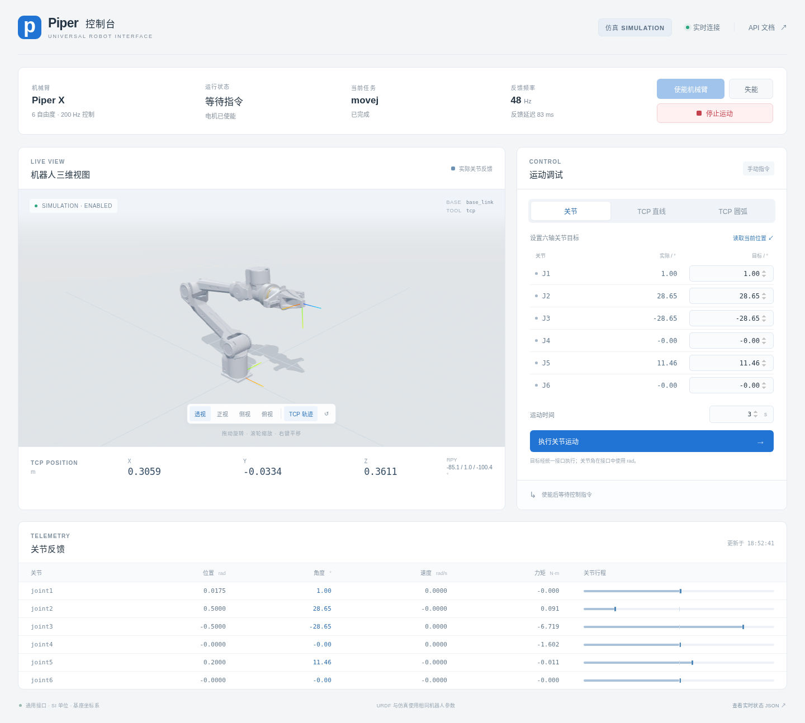

# Piper Control

AgileX Piper X 的通用机械臂服务：启动后等待上层命令，通过相同接口控制真机或
动力学仿真，并实时返回关节和 TCP 状态。提供 Python、HTTP/WebSocket 和 ROS 2
接口，以及可显示真实三维模型、执行基本调试运动的 Web dashboard。

本仓库复用 `~/Documents/Piper_workspace` 的 C++ SocketCAN 驱动、重力/摩擦补偿
与标定代码。`vendor/Piper_workspace` 只保留驱动、接口、模型及两种标定包，
附可选的超时位置保持补丁，以及就绪状态失效修复；本机原工作空间不改动。
无需启动原工作空间的摄像头、插孔、示教等应用。

默认位置控制参数已针对本机实测 J4 保持振荡修正，并增加被动 CAN 静止验收。
当前参数下完整 10 项真机运动验收、15 秒静止检查和 API 重启接管通过，运动验收
最大终点误差 `0.00955 rad`。
旧运动验收检查了轨迹终点，漏掉了静止振荡，不能用旧通过记录证明当前稳定性。
本轮调参与复验数据见 [验证记录](docs/validation.md) 和 [J4 诊断说明](docs/j4-vibration.md)。



## 快速启动

Python 3.10+ 可运行离线仿真；本机真机使用 Ubuntu 22.04、ROS 2 Humble 和 Python 3.10。

```bash
cd ~/Documents/piper_control
uv venv --python /usr/bin/python3 --system-site-packages .venv
uv pip install --python .venv/bin/python -r requirements.lock
uv pip install --python .venv/bin/python -e .

# 不依赖 ROS、CAN 或原工作空间的动力学仿真
.venv/bin/python -m piper_control --backend sim
```

打开 <http://127.0.0.1:8088>；仿真启动时失能，点击“使能机械臂”或调用 `enable()`。
请求格式见 <http://127.0.0.1:8088/docs>。

匹配本次真机标定的仿真：

```bash
.venv/bin/python -m piper_control --backend sim \
  --arm-config vendor/Piper_workspace/config/arms/arm_2.yaml --max-velocity 0.05
```

本机真机（`arm_2`，`can1`，带 PX6D 的夹爪）：

```bash
source scripts/env.sh
# 本机已有 control_msgs；新环境缺少时可用户目录安装：
# bash scripts/install_ros_extras.sh && source scripts/env.sh
python -m piper_control --backend hardware --arm arm_2 \
  --launch-driver --ros --max-velocity 3.141592653589793 --port 8090
```

真机 dashboard 为 <http://127.0.0.1:8090>。`--launch-driver` 会复用已运行驱动，
否则启动该臂的 C++ 驱动。首次启动底层驱动会使能电机，以实测位置初始化保持，
不自动归零；重连已有持久保持时继承原目标，不用静态跟踪误差重新设置目标。
原驱动启动时会配置从臂反馈，解决固件未主动上报的情况。仅附着已有驱动可省略
`--launch-driver`，随后显式调用 `enable()` 进入控制模式。

TCP 平滑性改进正在进行真机验证；本机当前 API 使用候选
[跟踪 profile](piper_control/assets/tcp_tracking.yaml)，启动参数另加：

```bash
--control-profile piper_control/assets/tcp_tracking.yaml --goal-tolerance 0.005
```

该 profile 启用硬件边界的电机/输出关节坐标转换、目标速度摩擦前馈、速度编码
余量、J1/J3 空间扰动补偿，以及有死区、限幅和限速的位置积分修正。当前 J2
摩擦前馈采用原模型输出的 1.75 倍，J6 为 1.5 倍；比例可逐轴配置，总前馈力矩仍受限。
积分死区为 0.003 rad，示例到位容差为 0.005 rad，避免继续追逐细小静态误差。
静止关节保留最后的坐标转换，避免编码器细小变化推动保持目标。电机相位
融合速度与带时间戳的位置反馈，避免放大位置量化。J4 按目标速度平滑切换运动和
静止阻尼；API 退出保持时冻结转换与积分，所有保活命令使用同一目标。
任务成功、超时、停止或实时流失联后也冻结积分，保留最后修正值；下一条运动
才继续修正，避免已报告结束的动作数秒后又因积分累积产生补动。
上层接口与 SI 单位保持一致。
参数针对当前 `arm_2` 和工具；尚不能将局部路径结果外推到整个工作空间。
当前进展、相机证据和未完成检查见 [TCP 排查记录](docs/tcp-motion-diagnosis.md)。
仿真可以加载同一 profile，复用增益、阻尼切换、位置积分、重力比例和目标速度摩擦前馈；其刚体模型
尚未复现电机空间扰动、双编码器弹性差值和 CAN 量化。

原工作空间不存在时，也可以在本仓库独立构建五个底层包：

```bash
bash scripts/build_vendor.sh
export PIPER_WORKSPACE="$PWD/vendor/Piper_workspace"
source scripts/env.sh
python -m piper_control --backend hardware --launch-driver --ros --max-velocity 3.141592653589793
```

`scripts/env.sh` 优先选择已构建的仓库内修订驱动，否则复用已安装的原工作空间；
显式设置的 `PIPER_WORKSPACE` 始终优先。本轮真机验收使用仓库内修订驱动。
CAN 应为已启用的 1 Mbps SocketCAN 接口；更换设备时修改所选工作空间的臂配置，
并使用该设备自己的标定。仓库内的标定是当前这台 `arm_2` 的快照。

## 上层控制器只使用通用接口

```python
from piper_control.client import RobotClient

with RobotClient("http://127.0.0.1:8090") as robot:
    robot.enable()
    state = robot.state()
    target = state["positions"].copy()
    target[0] += 0.02
    task = robot.trajectory([
        {"positions": target, "time_from_start": 2.0},
        {"positions": state["positions"], "time_from_start": 4.0},
    ], joint_names=state["joint_names"])
    robot.wait(task)  # 以实测反馈判断成功，而不是只等轨迹计时结束
```

换成仿真时只需改服务地址。另一个机器人实现相同后端或网络契约，也能继续使用
这些上层代码。客户端不导入 Piper 驱动，不访问 CAN，不判断机器人型号。

| 功能 | Python | HTTP / WebSocket | ROS 2 |
| --- | --- | --- | --- |
| 同构遥操 | `servo_joints(q)` | `/api/stream/joints`；`/ws/control` type=joints | `sensor_msgs/JointState` → `/robot/servo_joints` |
| 绝对 TCP 跟随 | `servo_pose(pose)` | `/api/stream/tcp`；type=tcp | `geometry_msgs/PoseStamped` → `/robot/servo_pose` |
| SpaceMouse 速度 | `servo_twist(v,w,frame)` | `/api/stream/twist`；type=twist | `geometry_msgs/TwistStamped` → `/robot/servo_twist` |
| 外部关节轨迹 | `trajectory(points,names)` | `/api/trajectory` | `control_msgs/FollowJointTrajectory` action |
| 关节/直线/圆弧 | `movej` / `movel` / `movec` | `/api/movej` / `movel` / `movec` | 同一控制器，可由 HTTP/Python 提交 |
| 实时状态 | `state()` | `/api/state`；`/ws/state` | `/robot/joint_states`、`tcp_pose`、`state` |
| 使能/停止/失能 | `enable` / `stop` / `disable` | 同名 `/api/` 端点 | `/robot/enable`、`stop` 服务 |

使用 REP-103 的 SI 单位：m、rad、rad/s、Nm；姿态四元数为 `[x,y,z,w]`，TCP
位姿在 `base_link` 系表达。默认 TCP 为原驱动法兰沿 z 偏移 0.16 m，可通过
`--tcp-offset x y z`、`--tcp-orientation qx qy qz qw` 更改。这是配置值，不能代替
实际工具标定。完整契约、错误及支持的 ROS action 字段见 [接口文档](docs/api.md)。

实时输入示例：

```bash
python examples/stream.py --url http://127.0.0.1:8090 --mode joints
python examples/stream.py --url http://127.0.0.1:8090 --mode twist
python examples/trajectory.py --url http://127.0.0.1:8090
```

例子中的信号可替换为主臂关节或 SpaceMouse 轴值。驱动补偿内环为 200 Hz；上层
建议使用 ROS 或持续 WebSocket，以 50–100 Hz 发送最新输入。HTTP/Python 网络层
不是硬实时控制系统。dashboard 是同一接口的客户端，和上层控制器共享指令入口。

## 执行语义与参数

- 关节限位、惯性和三维模型来自同一套 URDF。笛卡尔轨迹在执行前完成全路径采样
  逆解、分支连续性及速度检查；上层到达时间不会被静默改写。
- 未指定参数时，软件关节速度上限为 `0.3 rad/s`。当前真机启动示例使用
  `π rad/s`（180°/s）；J1–J5 生效为 180°/s，J6 受原模型的 `3 rad/s`
  限制，生效约 171.9°/s。Dashboard 的运动时间仍决定实际规划速度。
  文档中的低速真机验收使用 `0.05 rad/s`，不代表已验证 180°/s 的运动。
  `--max-velocity` 限制下发目标的速度，且不超过模型速度上限；实际速度受跟踪误差、
  阻尼和摩擦影响，可能短时超过指令上限。这不是硬件实际速度的保证值。
- 新轨迹与实时流从最后下发的位置目标接续，避免静态跟踪误差变成目标跳变。
  停止、取消和实时流超时会保持最后目标并将目标速度归零。实时流默认超时
  `0.2 s`，使用 `--stream-timeout` 配置。
  反馈中断或硬件报错会中止任务。停止后新输入可重新开始，生产者应停止旧流。
- 默认终点容差 `0.01 rad`、轨迹结束后最多等 `5 s`，可用 `--goal-tolerance` 和
  `--goal-timeout` 调整。失败会报告 `aborted`，不会把未到达伪报成成功。
- 默认 [位置控制 profile](piper_control/assets/position_control.yaml) 调整 J1–J4 的
  kp/kd，并以 `friction_scale=0` 关闭摩擦前馈，改善原柔顺参数的稳态误差与低速
  黏滑。J4 基础 `kp=32`、`kd=0.53`，替换会在本机保持时振荡的旧值 `64/2.12`。
  默认 profile 随服务启动加载；重力补偿和自适应刚度仍使用原设置，所有覆盖仅在
  运行时应用，不改臂配置、模型或标定文件。`--control-profile source` 恢复原增益和所选臂的摩擦补偿比例
  （当前 `arm_2` 为 `0.88`）。自定义 YAML 同样适用于真机与仿真，关闭摩擦前馈
  不会移除仿真中的物理摩擦负载。具体参数及遥测字段见 [真机文档](docs/hardware.md)。
- 正常退出 API 持续使用 MIT 固定目标保持，不切换固件运动模式。新驱动可自行
  保持超时目标；未修改的旧驱动由独立 ROS 保持进程接管，重启 API 后交回控制。
  保留底层驱动，显式失能不同于保持，见 [真机文档](docs/hardware.md)。

默认服务仅绑定本机，无身份认证；外部网络部署需要自己的访问控制。该项目不做
环境碰撞规划或接触力安全判定。仿真复用物理参数与标定，但没有完整电机、静摩擦
锁止、CAN 延迟或接触辨识模型，见 [仿真文档](docs/simulation.md)。

## 验证与仓库结构

```bash
source scripts/env.sh
PYTEST_DISABLE_PLUGIN_AUTOLOAD=1 python -m pytest -q

# 会通过公开接口实际运动：约 0.02 rad 关节目标、微小 TCP 路径和实时流。
python scripts/acceptance.py --url http://127.0.0.1:8090 \
  --output .runtime/hardware-acceptance.json

# 静止验收：仅接收 CAN，不发送帧；应在机器人已经保持目标时运行
python scripts/diagnose_hold.py --can can1 --seconds 15 \
  --output .runtime/hold.json --max-speed-rms 0.01 --max-current-ac-rms 0.02
# 如需同时采音，在上一命令加 --audio .runtime/hold.wav

# 短时原始总线检查
python scripts/probe_can.py --interface can1 --duration 2

# TCP 质量记录（会实际运动）；相机工具可用 pip install -e '.[diagnostics]' 安装
python scripts/record_tcp_motion.py --case line_z --distance .03 --speed .02 \
  --out .runtime/tcp-check
python scripts/analyze_tcp_camera.py .runtime/tcp-check
python scripts/analyze_tcp_timing.py .runtime/tcp-check

# 本机 BRIO 以原生 1920x1080 采集，保存工具附近区域，保留约 60 fps
python scripts/record_tcp_motion.py --case line_z --distance .02 --speed .02 \
  --camera-focus 10 --camera-resolution 1920 1080 --camera-roi 300 420 1000 660 \
  --post-motion-seconds 5 --out .runtime/tcp-hd-check
python scripts/stabilize_tcp_camera.py .runtime/tcp-hd-check
python scripts/analyze_tcp_timing.py --camera-data camera-stabilized.npz .runtime/tcp-hd-check
```

相机分析使用本次 BRIO 机位的固定工具区域；换机位后先检查输出的
`camera-tracking-features.jpg`。直线时间律分析不适用于圆弧；相机像素速度不是
经过空间标定的 TCP 速度，记录中的实际到位状态与平顺性应分别检查。
背景校正的像素位移统一归一化到完整 960 像素宽画面；提高采集分辨率不会
改变指标单位。时间律分析读取实际关节参考及 Jacobian，并单独报告完整录像的
速度误差、计划结束 0.5 秒后的补动和最后 0.5 秒稳定性，不能只看计划时段。

验收结果及实测误差见 [验证记录](docs/validation.md)。测试覆盖模型与原驱动一致性、
动力学、直线/圆弧几何、命名关节轨迹、超限/不可达预检查、看门狗、停止、并发
规划失效、HTTP/WebSocket 和真实 ROS action 传输。浏览器测试加载本地 STL 模型，
通过真实仿真 API 操作关节、直线和圆弧。

静止诊断检查每个关节的采样完整性、速度 RMS、电流交流 RMS 及位置变化；缺帧会
失败，不会把没有数据当成零振动。上述阈值是本台机器、本次姿态的实测验收门槛，
不代表通用安全保证。可选音频报告 80–84 Hz 数字功率 dBFS，未经声压或时延标定。
仿真没有复现固件高频动态，仿真通过不能证明真机保持稳定。

```text
piper_control/
  model.py                 同源 URDF 运动学、TCP、IK、Jacobian
  planning.py              通用关节轨迹、movel、movec
  controller.py            执行、状态机、实时流和看门狗
  backends/                仿真、现有 C++ 驱动的 ROS 适配
  server.py / client.py     通用 HTTP/WebSocket 和 Python SDK
  ros_bridge.py            ROS 标准消息、服务和 action
  web/                     本地依赖的三维 dashboard
  assets/                  模型、网格、位置控制参数
vendor/Piper_workspace/     五个核心包、可选保持补丁、标定快照与来源校验
scripts/                   构建、环境、只读诊断和验收
examples/                  不依赖机器人型号的上层示例
```

原始代码、模型和前端依赖保留各自许可证与来源，见
[复用清单](vendor/Piper_workspace/README.md) 和模型目录说明。Dashboard 布局参考
[ur15_crisp](https://github.com/yizhongzhang1989/ur15_crisp)，界面代码在本仓库实现。
