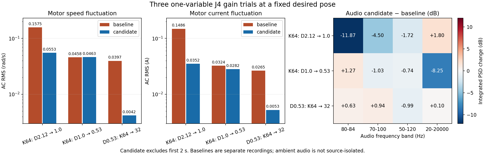

# J4 静止振荡：原因、修复与真机复验

2026-11-26，`arm_2 / can1`，带 PX6D 的夹爪。

本仓库此前为减小位置误差提高了 J4 的 PD 增益，诱发或放大了电机局部闭环振荡。
在目标、重力补偿和其他五轴参数不变的条件下，分开降低阻尼与刚度后，振荡显著下降。
最终基础参数为 **`kp=32, kd=0.53`**，已写入默认
[位置控制配置](../piper_control/assets/position_control.yaml)，当前真机也已应用。

原默认值为 `64/2.12`；由于保留的自适应刚度 `s_a=2`，小误差处实际约为
`192/3.67`，分别是原参考配置 J4 的 16 倍和 4 倍。修复后实际约为 `96/0.918`。
其他关节、重力比例、摩擦前馈关闭状态和原工作空间标定文件保持不变。

## 原因证据

静止时六路 MIT 报文内容恒定，J4 速度与电流仍有周期波动；这将问题定位到固定
指令下的电机闭环响应。三轮试验均以 4 s 平滑改变一个参数，保留同一名义目标。
下表为每轮自身的前后窗口，后窗口排除参数变化后的前 2 s；各轮背景条件不同。

| 单变量试验 | J4 速度 RMS，rad/s | J4 电流交流 RMS，A |
| --- | --- | --- |
| `kp=64`，`kd: 2.12→1.0` | `0.15750→0.05531` | `0.14856→0.03523` |
| `kp=64`，`kd: 1.0→0.53` | `0.04587→0.04636` | `0.03244→0.02823` |
| `kd=0.53`，`kp: 64→32` | `0.03972→0.00420` | `0.02651→0.00526` |

第二步没有进一步降低速度波动，因此不能把三步说成速度单调改善。最终组合经
真实运动和静止复验确认。降低刚度时，原驱动按 `重力力矩/kp` 调整 MIT 的位置
字段；还原后的名义目标偏差始终小于一个位置量化单位，不能把这一编码变化误当
作上层目标跳变。普通关节角度反馈未变，但电机位置反馈均值变化约 1.78 mrad；
两种位置反馈不能混为一谈。



关键实现依据是原驱动的[自适应增益](../vendor/Piper_workspace/src/piper_x_driver/src/controller.cpp)、
[MIT 量化与重力偏移编码](../vendor/Piper_workspace/src/piper_x_driver/src/can_protocol.cpp)。
名义刚体模型的阻尼估算不保证真实固件内部速度估计、延迟和机械柔性环节的稳定性。
本次确定了可修正的增益诱因，未确认其中某一个固件内部环节为唯一物理机制。

首轮录音的 80–84 Hz 声能降低约 12 dB；后续两轮没有进一步整体降噪的证据。
房间内其他声源仍然存在，不能把全部录音都归因于机械臂。100 Hz 电机遥测不能
唯一还原 50 Hz 以上的机械频率；约 18 Hz 遥测峰与约 82 Hz 声峰只是可能的混叠
关系。90 帧/秒摄像头确认无明显整体姿态变化，但未可靠分辨超出背景噪声的微振。

## 修复后验收

- J4 从原名义目标增加 `0.02 rad` 再返回，每段 4 s；真实去程变化 `0.01862 rad`，
  两个终点误差分别为 `0.00848 / 0.00707 rad`。各终点继续保持并采集 CAN，速度
  RMS 为 `0 / 0.00394 rad/s`。
- 默认配置下完整 10 项真机接口验收通过，最大终点误差 `0.00955 rad`：
  [完整记录](hardware-acceptance-j4-fix.json)。包括关节轨迹、movel/movec、三种实时流、
  看门狗与取消。
- API 重启保留原目标、原关节姿态及底层驱动 PID，没有模式/使能控制帧：
  [重启记录](j4-restart-verification.json)。
- 8 s 返回最初名义目标，终点误差 `0.009983 rad`；随后 15 s 静止检查通过。
  J4 速度反馈 RMS 为 `0`，电流交流 RMS 为 `0.004251 A`；六路反馈完整且六路
  MIT 报文各自恒定：[静止记录](j4-hold-final.json)。速度为零指反馈分辨率内为零。

本次静止检查门槛为各轴速度 RMS ≤`0.01 rad/s`、电流交流 RMS ≤`0.02 A`，
是这台机器、当前工具和姿态的调试验收门槛，不是通用机械安全限值。真机测试仍
限定小幅低速路径；`0.05 rad/s` 的目标速度限制不能当作实际速度硬上限。

## 一并修复的接管问题与仿真伪影

试验期间有三次诊断中断。首次在 100 ms 就绪窗口尚未建立时提前检查，中止且
没有改变姿态；另两次重连接管暴露了独立的初始化时序问题：使能有效性或控制
状态尚未确认时，适配层可能把测量位置当作原目标，甚至在配置服务的 keepalive
中先行发送。两次 J4 短暂变化均约 `0.009 rad`；试验中止并恢复原目标，期间未切
模式、未失能、未终止底层驱动。这不是此前恒定指令下高频振荡的原因。

适配层现在从同一锁内的快照确认新鲜使能状态、固件模式和驱动保持目标，之后才
允许发送首条命令或配置 keepalive。信息缺失时等待或明确超时，避免回退到测量
位置。新增回归覆盖状态到达顺序、过期控制信息、目标缺失及配置 keepalive。

仿真另外存在一个数值伪影：将速度相关物理摩擦负载保持整个 5 ms 控制周期，
可能在零速附近注入数值振荡。现在物理摩擦随每个 1 ms 物理子步的实际速度更新，
控制补偿仍按 200 Hz 更新；新增回归验证保留摩擦负载时的小运动衰减。
这项修正与真机增益问题分别处理，仿真仍不包含固件内部高频动态。

此前仅依靠轨迹到位的验收遗漏了静止振动和噪声检查。现保留全部历史记录，补充
[本次诊断数据](j4-vibration-diagnosis.json)及可复用的被动采样工具：

```bash
source scripts/env.sh
python scripts/diagnose_hold.py --can can1 --seconds 15 \
  --output .runtime/hold-check.json --audio .runtime/hold-check.wav \
  --max-speed-rms .01 --max-current-ac-rms .02
```

该工具仅接收 CAN，缺路、缺帧或超限会失败；不会启用电机、调整参数或发送运动。
