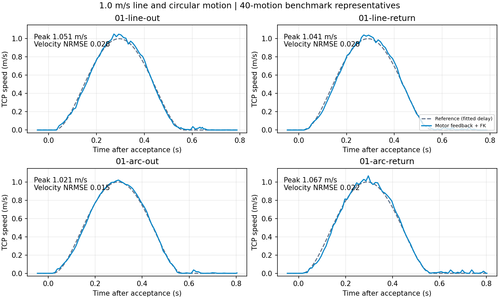
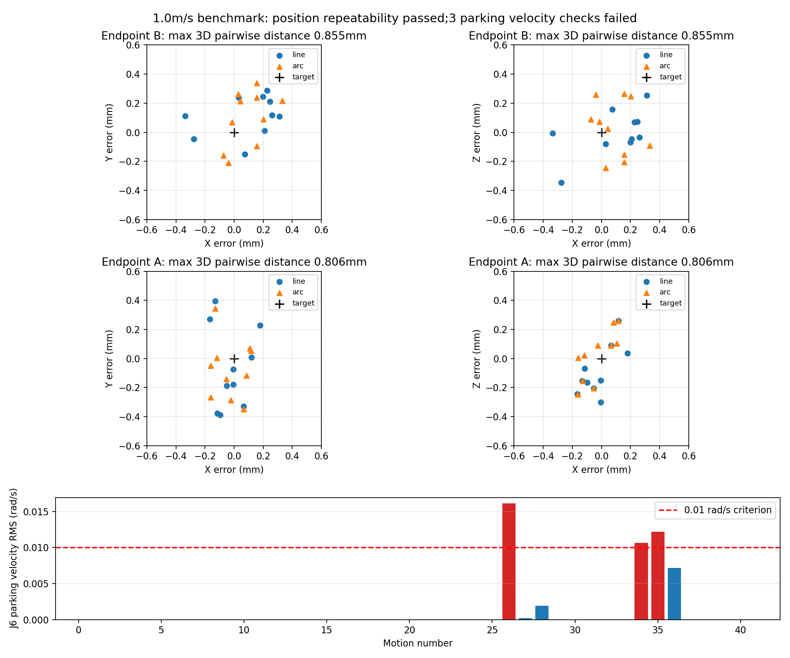
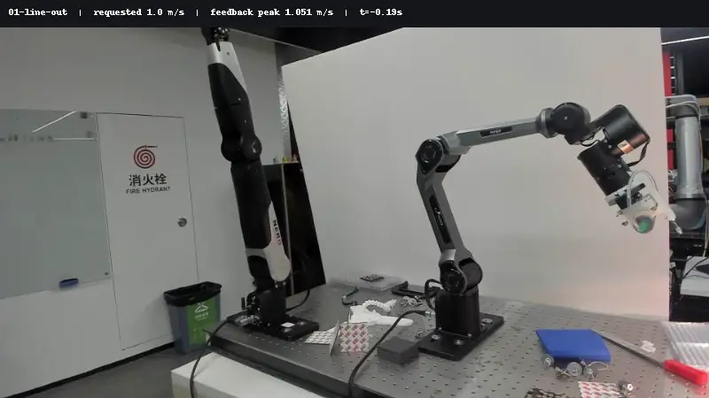

# TCP 高速与重复定位验证

本页汇总高速实测，历史诊断见 [TCP 排查记录](tcp-motion-diagnosis.md)。
目标为可达路径峰值 1.0 m/s、重复停稳点最大间距 ≤1 mm。
报告保留失败检查，不将单次到位误差当作重复定位精度。

## 40 次高速运动

`gated-wrist001-highspeed` 包含直线、圆弧各 10 次往返，A/B 两端各 20 次停稳。
40 次控制器任务全部成功；反馈重复定位通过 1 mm 目标，但 3 次静止速度检查超限，
因此这组的严格综合质量状态仍为失败。

| 指标 | 实测 |
| --- | ---: |
| TCP 峰值速度（电机速度反馈 + FK） | 1.017–1.067 m/s |
| 速度向量归一化 RMS 误差 | 0.0153–0.0323 |
| 中段低速停顿比例 | 所有 40 次均为 0 |
| A 点最大重复间距，20 次 | 0.806 mm |
| B 点最大重复间距，20 次 | 0.855 mm |
| 最终 TCP 目标偏差 | 0.101–0.446 mm |
| 轨迹结束到宣布停稳 | 1.20–8.66 s |
| 原始输出角 FK 的最大路径偏差 | 0.174–3.544 mm |

“中段”取延迟对齐后的轨迹时间 20%–80%；沿参考方向的实测速度低于参考的
15% 计为停顿。该指标没有检测到原先的走停交替，但不代表任意姿态、负载、速度下
都不存在抖动。输出反馈置零区间的跳变也可能放大原始路径偏差。

三次未通过的项目均为 J6 在末尾 2 s 的速度 RMS：

| 记录 | J6 RMS | 检查上限 |
| --- | ---: | ---: |
| 07-line-return | 0.01613 rad/s | 0.01 rad/s |
| 09-line-return | 0.01065 rad/s | 0.01 rad/s |
| 09-arc-out | 0.01216 rad/s | 0.01 rad/s |

这些记录在宣布成功后的 J6 MIT 报文均只有一个唯一载荷，外层保持指令没有改变；
停车窗口未检测到 TCP 反馈漂移，电流交流 RMS 也通过 0.02 A 检查。
这排除了这三次事件由外层持续改变命令引起的解释，但尚不能将短速度脉冲定性为
纯反馈伪影，或证明腕部完全没有微小运动。

完整指标和对应 profile：[机器可读报告](tcp-highspeed-repeatability.json)。

## 相机证据和测量边界

动画按相机主机时间戳选取约 30 fps 的片段，以约实时时间播放，省略大部分停车等待。
[片段来源](tcp-highspeed-camera.json) 保留采集帧率和记录路径。
同一 A 点 20 次停车图像经固定背景配准后，工具特征最大两两位移为约 **1.031 px**，
归一化到全幅宽度 960 px；见 [图像比较](tcp-highspeed-camera-returns.json)。

毫米指标来自关节反馈与配置的 FK。固件零区间使用明确标记的电机估算，电机位置
分辨率约 1 mrad；原始读数保留。相机没有三维空间标定，因此上述结果只能证明
本组路径的反馈重复性和画面内一致性，不能宣称已经完成外部三维绝对精度计量。

## 停车修正的后续验证

高速积分冻结后，仍观察到电机已移动、标准关节角保持旧值的阶段。可选的
`tracking.position_integral.motor_lead_limit` 在积分内部计入这段电机位移，
限制为不超过配置值，遇到新的输出角重新锚定，并按 `motor_lead_time` 指数衰减。
它不修改对外状态、控制器到位判断或本页的精度统计。默认限幅为零，保持原行为。
对应仿真使用真实仿真关节角，不人为注入固件的反馈缺陷。

将 J6 基础 kp 从 3 降到 1.5 的探索在多平面运动中出现修正饱和和超时，已恢复 kp=3。
后续多平面复验保留 0.45 mm 到位阈值，并延长等待窗口，用来区分“最终不能到位”与
“能到位但耗时过长”；等待时间单独计分，不等同于 TCP 运动时长。

随后 `precision30-orthogonal` 完成了 XY/XZ/YZ 三平面的 18 次 0.5 m/s 圆弧。
控制器任务全部成功，但 X 端点最大重复间距为 1.140 mm：其中一次停车后 J5
电机估算位置改变约 3 mrad，TCP 偏差增加到 0.847 mm。另一次 J4 有约 1 mrad
的电机往复；两次事件的保持指令均固定。该组不能计作重复定位和静止质量通过，
完整记录见 [多平面阶段报告](tcp-multiplane-stage.json)。

目前正在复验较低腕部刚度。以上 40 次结果对应报告内记录的 profile，不能归于后续候选参数。
