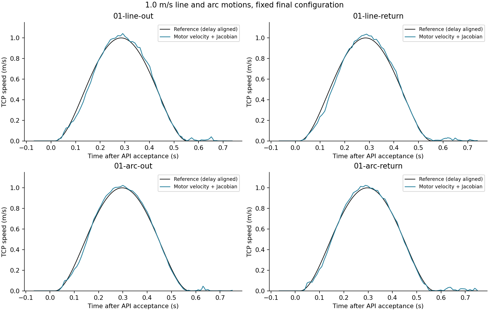
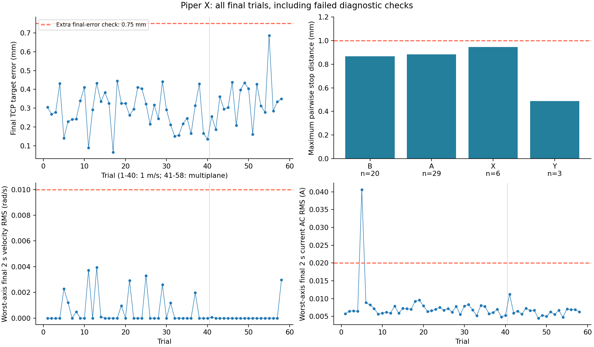
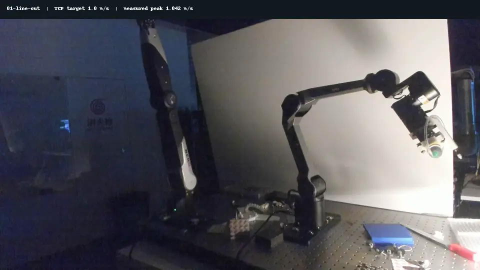

# TCP 高速与重复定位验证（2026-11-26）

固定同一套参数完成 **40 次 1.0 m/s 直线/圆弧和 18 次 0.5 m/s 多平面圆弧**，
58 个任务全部成功。测试路径达到高速目标；合并各路径的相同终点后，反馈重复
定位最大间距 **0.945 mm**，通过 ≤1 mm 目标。两项附加静止诊断未通过，
因此机器可读报告保留 `strict_quality_passed=false`，不能称为全部质量检查通过。

[完整数据、配置快照与逐次结果](tcp-final-validation.json) ·
[实拍片段](tcp-final-camera.webp) · [API 文档](api.md)

## 测试范围和结果

设备为 `arm_2 / can1`，带 PX6D 和夹爪，TCP 偏移 0.16 m；使用
[tcp_tracking.yaml](../piper_control/assets/tcp_tracking.yaml)。
运动通过通用 HTTP/Python 接口提交，同时被动记录 CAN 和约 60 fps 相机视频。
最终记录位于 `.runtime/tcp-smooth/rms-zero-final-validation/`。

| 指标 | 40 次高速直线/圆弧 | 18 次 XY/XZ/YZ 圆弧 |
| --- | ---: | ---: |
| 请求 TCP 峰值 | 1.0 m/s | 0.5 m/s |
| 电机速度反馈 + Jacobian 峰值 | 1.013–1.049 m/s | 0.506–0.584 m/s |
| 速度向量归一化 RMS 误差 | 0.0143–0.0325 | 0.0621–0.0899 |
| 中段低速停顿比例 | 每次均为 0 | 每次均为 0 |
| 最终 TCP 目标偏差 | 0.066–0.445 mm | 0.161–0.686 mm |
| 末尾 2 s 最大关节速度 RMS | 0.00394 rad/s | 0.00297 rad/s |
| 轨迹结束到报告停稳 | 4.12–29.88 s | 5.24–25.63 s |
| 原始输出角 FK 最大路径偏差 | 0.176–4.743 mm | 2.932–6.694 mm |

中段取延迟对齐后轨迹时间的 20%–80%，沿参考方向的速度低于参考的 15% 计为
低速停顿。该指标和曲线未检出原先的中途走停交替；它不能证明任意姿态、负载或
速度都没有抖动。输出反馈置零转换可能放大原始路径偏差。**1 mm 是重复终点目标，
不是本轮已达到的全路径跟踪误差。**



同一目标位置和姿态的记录合并统计，不只在各自路径内部比较：

| 目标 | 停稳次数 | 最大两两间距 |
| --- | ---: | ---: |
| A，公共返回点 | 29 | 0.883 mm |
| B，高速远端 | 20 | 0.869 mm |
| X，XY/XZ 公共远端 | 6 | 0.945 mm |
| Y，YZ 远端 | 3 | 0.488 mm |



高速主行程约 0.54–0.55 s，随后还有修正与停稳确认。轨迹结束后，位置首次进入
1 mm 且持续保持到采集结束的最迟时间为高速组 **9.58 s**、多平面组 **16.17 s**。
这些长尾限制了点到点任务的节拍；不能用主行程速度掩盖停车收敛时间。
到位条件是 TCP 0.45 mm、逐轴关节容差、1 s 时间加权速度 RMS ≤0.01 rad/s，
连续满足 3 s，最多等待 30 s。速度 RMS 只用于完成判据，原始速度仍完整对外报告。
实时流不等待这个任务完成判据。

## 两项未通过的附加诊断

| 记录 | 未通过项 | 实测 / 附加检查值 |
| --- | --- | ---: |
| 高速 `02-line-out` | J2 末尾 2 s 电流交流 RMS | 0.04063 / 0.02 A |
| 多平面 `03-arc-xz-500-out` | 报告成功后的 TCP 变化 | 0.585 / 0.5 mm |

第一项对应 J2 电机位置在两个相邻 1 mrad 读数之间变化，速度 RMS 为
0.00228 rad/s，TCP 输出反馈不变。独立的后续 10 s 保持检查通过后，继续了
剩余固定次数的运动；原失败没有删除或改为通过。

第二项对应 J5 在报告成功后约 0.5 s 内发生约 3 mrad 电机反馈变化，最终 TCP
偏差为 0.686 mm，计入 X 点的重复定位结果。这两次事件的对应关节 MIT 保持
报文各只有一个唯一载荷，说明外层保持目标没有继续变化。
相机背景校正后的工具图像变化分别为约 0.919 / 0.403 px；不能据此排除实际
微小运动，也不能将它们断定为纯反馈伪影。
[事件证据](tcp-final-diagnostic-events.json) 保留原始指标、相机来源及保持检查。

整套运动后另做 [15 s 被动静止检查](tcp-final-hold.json)，全部通过：六轴各收到
约 1500 帧速度反馈和 3000 帧 MIT 命令；本窗口六轴速度量化读数为零，最大电流
交流 RMS 为 0.00590 A。它不追溯取消前述两项失败，也不代表无限分辨率的零运动。

## 相机与精度测量边界



动画按主机相机时间戳选取约 30 fps、近似实时播放，省略大部分停车等待，
[来源](tcp-final-camera.json) 可追溯到原始视频。
A 点 29 次停车图像在固定背景配准后，工具特征最大两两位移约 **1.332 px**，
统一为全幅 960 像素宽；[图像结果](tcp-final-camera-returns.json) 和
[特征位置](tcp-final-camera-returns.features.jpg) 保留用于复核。

毫米指标来自关节反馈及配置 FK。固件真实零读数使用有明确标记的电机估算，
电机位置分辨率约 1 mrad；有效非零输出和原始 CAN 数据保留。
相机没有三维空间标定。本报告证明本机、本工具和这些路径的反馈重复性及
画面内一致性，**不是外部三维绝对精度计量或 ISO 9283 认证**。

## 修复与复现

- 收紧连续逆解收敛容差，用同一 C2 样条生成关节位置和速度，圆弧姿态连续通过中间点。
- 复用原驱动及重力/摩擦标定，增加运动动力学前馈和时间对齐的电机/输出坐标转换。
- 分开运动与静止阻尼，平滑过渡；高速段冻结积分，停车修正使用有界、可衰减的电机位移预测。
- 任务结束后冻结修正，保持最后命令；API 接管继承原保持目标。
- 修复将小于 0.3° 的有效非零反馈误当作零值的问题；跨零插值带来源标记，不能污染坐标学习。
  早先 40 次计划在第 20 次由此中止，失败记录保留，见 [零位反馈说明](tcp-zero-feedback.md)。

```bash
# 真机 dashboard：http://127.0.0.1:8090
bash scripts/start.sh hardware
# 匹配参数的仿真：http://127.0.0.1:8088
bash scripts/start.sh sim
```

复验脚本为 `scripts/run_tcp_suite.py`，路径清单为
[高速清单](tcp-final-highspeed-suite.json) 和 [多平面清单](tcp-final-orthogonal-suite.json)。
清单对应本次已检查的 A 起点、工具和工作区，不适用于任意起始姿态。
其严格默认检查会在未通过项处停止；本次 J2 电流事件经过单独保持复核后继续，
续测原因记录在完整报告中。

软件测试 **145 项通过**。同参数仿真完成过 [10 项通用接口验收](tcp-profile-simulation-acceptance.json)；新增 1 s RMS
完成判据后，另通过 [关节、直线和圆弧 3 项仿真检查](tcp-rms-simulation-smoke.json)。
[安装包检查](tcp-final-wheel.json) 确认 56 个包内文件与源码一致，并在独立解包目录
运行了动力学仿真。Dashboard 复核包含实时状态、三维模型、1 m/s 输入和移动端布局，
[检查](dashboard-highspeed-verification.json) 的控制 POST 全部被拦截，没有额外真机运动。

历史参数和未通过实验继续保留：[高速阶段记录](tcp-highspeed-stage-history.md)、
[多平面早期报告](tcp-multiplane-stage.json)、[停车诊断](tcp-stop-diagnosis.md)、
[J4 振荡原因与修复](j4-vibration.md)。历史通过结果不替代当前配置的实测。
