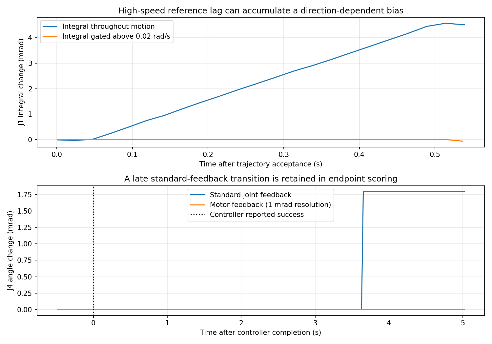

# 高速停车与反馈诊断

本页保留阶段诊断；当前配置的整组结果见 [高速验证汇总](tcp-highspeed-validation.md)。
不能把单次到位或运动平顺当作整组验收通过。
目标为可达路径 TCP 峰值 1.0 m/s、重复停稳点最大间距 ≤1 mm。
停止指标使用关节反馈与配置 FK，固件零区间采用有来源标记的电机估算；
这不是外部三维计量。原始 CAN、API 状态和相机视频保存在 `.runtime/tcp-smooth/`。



## 已复现的问题

- 旧到位条件为 TCP 0.75 mm、连续静止 0.5 s。长序列的第 30 次运动超时，
  返回点最大重复间距 1.152 mm，未通过 1 mm 目标；此前 3 轮的小样本通过不能替代它。
- 收紧到 TCP 0.4 mm、连续静止 1 s 后，7 次运动到位，下一次停在 0.427 mm
  而超时。内部检查随后采用 0.45 mm；单次偏差和整组最大重复间距仍分别计分。
- 一次返回在控制器宣布成功 3.65 s 后，J4 标准关节角跳变约 1.8 mrad，
  最终 TCP 反馈误差从 0.179 变为 0.522 mm；期间电机角读数未改变。
  固定背景校正后的工具图像最大位移约 0.070 px，不能排除深度方向变化。
  原始跳变保留在停车指标中，未通过修改反馈消除超限。
- 停车修正时，电机角已变化约 1 mrad，标准关节角可能暂不改变，随后跳变约
  2 mrad。持续积分可能因此产生迟到修正和过冲。具体固件内部机制尚未确认。

控制器终态新增 `finished_timestamp` 和 `finished_monotonic_time`，记录实际
宣布完成、中止或取消的事件。分析优先使用该时间，避免漏掉客户端下一次轮询之前的变化。
历史记录没有该字段时仍明确标为 `client_poll`。
诊断数据见 [JSON](tcp-stop-diagnosis.json)，其中失败运动始终保留失败状态。

## 积分与阻尼的分开检查

0.54 s 高速往返会让 J1 积分偏置改变约 4 mrad。新增可选参数：

```yaml
tracking:
  position_integral:
    max_velocity: 0.02  # 任一关节参考速度超过此值时冻结全部位置积分，rad/s
```

冻结使用参考速度，避免把高速反馈延迟累积成静态负载补偿。低于门槛后保留原有
死区、修正限幅和限速。仿真与真机采用相同规则；默认未设置此项时保持原行为。
试验确认高速段偏置不再变化，但仅这一项没有解决所有停车问题。

一个候选终点的 J1 仍持续轻微振荡。10 s 被动 CAN 检查中，2,000 条 J1 MIT
保持报文完全相同，积分已冻结，因此该次振荡不来自外层继续修正。
静止阻尼逐级降低的结果如下；增益过渡匹配原保持力矩，底层驱动持续运行。

| J1 静止 kd | 10 s 速度 RMS（rad/s） | 静止阈值 0.01 rad/s |
| --- | ---: | --- |
| 8 | 0.01254 | 未通过 |
| 6 | 0.00806 | 通过 |
| 4 | 0.00351 | 通过 |

kd=4 的一次 1.0 m/s 返回实测峰值 1.040 m/s、速度曲线归一化误差 0.0242、
停稳误差 0.296 mm，完成后未检测到漂移。该配置仍须完整往返和多平面验证。
运行中的候选 profile 位于 `.runtime/tcp-smooth/highspeed-gated-j1kd4.yaml`，
不要把候选单次结果视为仓库默认配置已完成验收。

厂商也明确建议外部控制采用 200 Hz，反馈频率由主控限制；继续提高发送频率
不能解决这些问题：[厂商答复](https://github.com/agilexrobotics/piper_sdk/issues/130#issuecomment-6438725610)。
