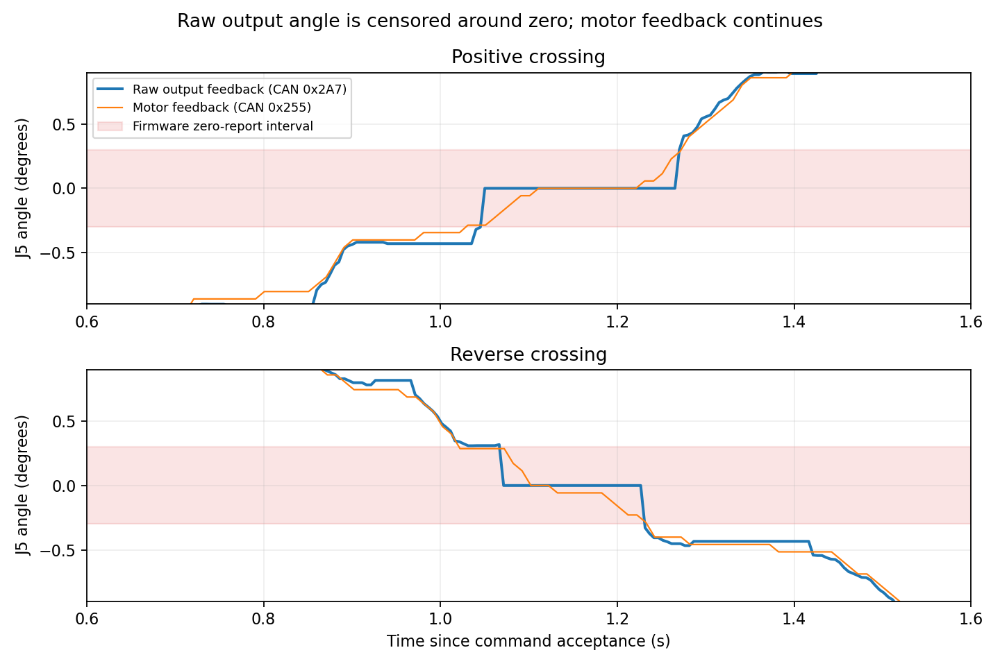

# 零位附近的固件角度反馈

本机固件 `S-V1.9-1` 的 J5 标准关节反馈在约 ±0.3° 内返回零。
双向小范围运动中，原始 `0x2A7` 报文的最近非零值约为 −0.302° / +0.301°，
而 `0x255` 电机角反馈在零读数期间从约 −0.005 rad 经过 +0.005 rad。
仓库内原驱动对此字段只做有符号整数和单位转换，没有软件置零操作。
原始记录摘要见 [诊断数据](tcp-zero-feedback-diagnosis.json)。



这使 −0.00345 rad 等小角度无法由标准反馈直接分辨。如果把零值用于学习
电机/输出坐标差，或者对它累积位置误差，会误改坐标转换与积分修正。
这与高速运动的惯性耦合是两个问题；不能将全部机械误差都归因于反馈置零。

跟踪后端新增可选配置：

```yaml
tracking:
  feedback_zero_band: 0.005235987755982988  # rad，即 0.3°
```

实际非零输出读数直接保留，并记录电机与输出的关系；即使它小于 0.3°，也不能
把有效非零数据当成零值。只有原始零值使用电机角和最近有效关系估算关节角，
结果限制在配置区间内。涉及零值的时间插值明确携带来源标记，并冻结该轴的
坐标学习，避免插值得到的假非零值污染坐标转换。运动中只用对齐
时间的反馈建立关系；静止时允许使用新鲜的低速反馈。有效关系随保持检查点
保存，API 重启继承原驱动目标。过期反馈或明显不一致的电机读数仍会触发失败。

`extra.feedback_reconstruction` 保留 `raw_positions`、`inferred`、`anchored`、
偏移及电机分辨率。尚未观察到有效非零读数的轴暂用已保存的坐标转换，其
`anchored` 为 false；因此不能将它当作已经校准的输出测量。
ROS 和通用 API 使用相同的关节状态。默认关闭此修正，仿真不模拟固件置零。

电机位置分辨率为 0.001 rad。这是有来源标记的状态估计，不是外部三维计量，
也不意味着机械臂绝对精度达到 0.001 rad。启用后，运动分析保留原始 CAN 曲线
和 `raw_output_*` 停止指标，另报 API 估算停止指标；未经有效关联且会影响 TCP
位置的轴不能用于通过重复定位验收。相机图像仍只报告像素，未换算成毫米。

初步真机检查：修正启用时原始关节读数与执行器保持目标均未改变，10 秒
静止检查通过。120 mm XZ 圆弧的三次往返通过，两个目标点的最大重复间距
为 0.69 / 0.90 mm（编码器/电机估算与配置 FK）。更广路径与高速复验仍在进行。

后续 1 m/s 长序列在第 20 次圆弧返回时暴露了上述区分的重要性：J1 原始输出为
`0.005078908 rad`（约 0.291°），电机反馈为 `0.006 rad`。旧实现把所有小于
0.3° 的角度都当作零值，先截断该有效读数，随后误报一致性故障并中止任务。
现已修正；回归测试保留这组数值，并检查跨零插值不会建立错误锚点。
原失败记录保留在 `.runtime/tcp-smooth/rms-final-validation/highspeed/05-arc-return`。
